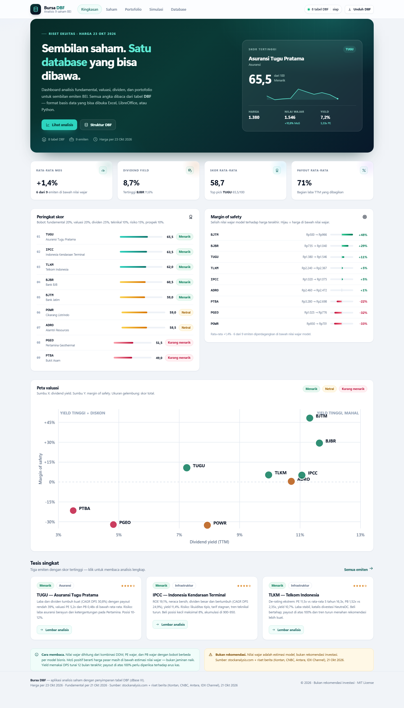
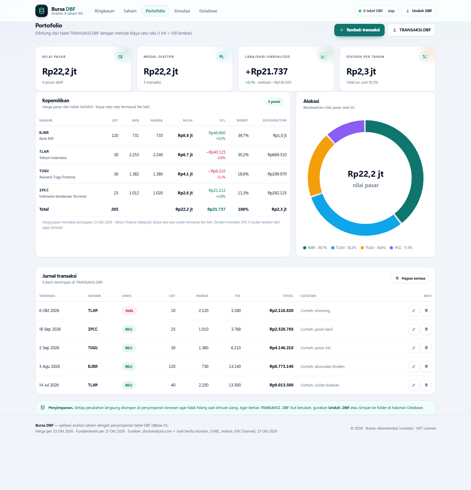
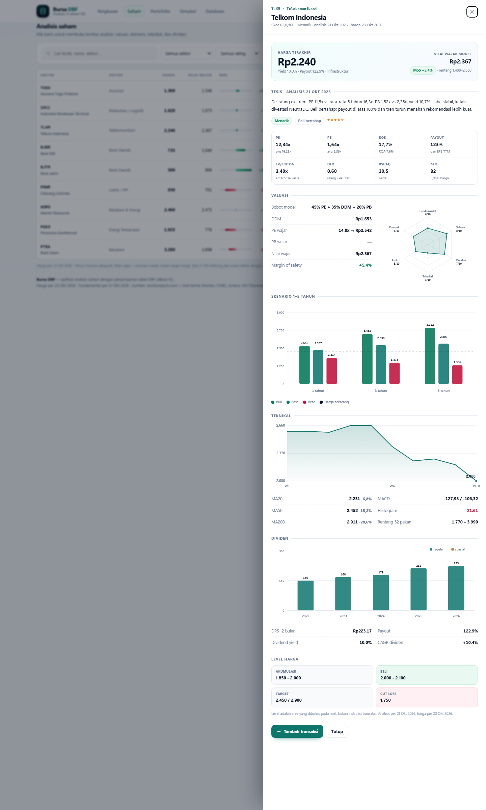
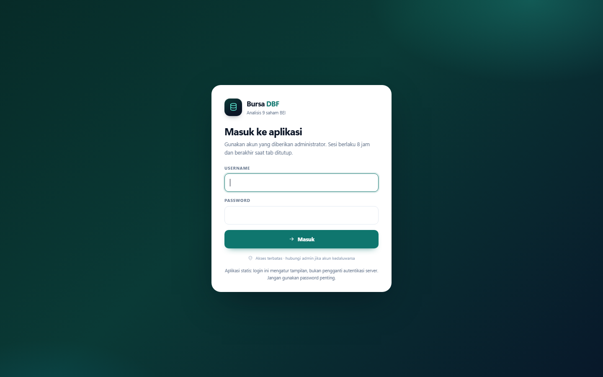

# Bursa DBF

Aplikasi web untuk analisis **9 saham Bursa Efek Indonesia** dengan penyimpanan data berupa
tabel **DBF (dBase III)** — bukan JSON atau database server. Seluruh angka dibaca langsung dari
berkas `.DBF` di folder [`data/`](data), dan perubahan portofolio dapat ditulis kembali menjadi
berkas `.DBF` yang sah.

**Live:** <https://4r1b0nek.github.io/bursa-dbf/> · **Repo:** <https://github.com/4r1b0nek/bursa-dbf>



> Analisis fundamental per **21 Oktober 2026**. Harga saham dapat diperbarui manual atau
> otomatis dari Yahoo Finance setelah tanggal tersebut. Aplikasi ini bukan rekomendasi investasi.

## Kenapa DBF?

DBF adalah format tabel yang sudah dipakai puluhan tahun dan tetap bisa dibuka oleh
**Excel, LibreOffice Calc, Python (`dbfread`), FoxPro**, serta aplikasi akuntansi lama.
Dengan format ini, hasil analisis tidak terkunci di dalam aplikasi web: berkasnya bisa
diperiksa, diolah, atau dicetak dengan alat apa pun.

Aplikasi ini menulis sendiri pembaca/penulis DBF di JavaScript (tanpa library), sehingga
tidak memerlukan server, build step, atau basis data tambahan.

## Fitur

- **Ringkasan** — skor 9 emiten, margin of safety, dividend yield, peta valuasi (yield vs MoS),
  dan tesis singkat.
- **Analisis saham** — tabel yang bisa dicari, difilter per sektor/rating, dan diurutkan.
- **Update harga** — ubah harga terbaru 9 emiten; PE, PB, DY, dan MoS dihitung ulang otomatis,
  lalu dapat diekspor kembali ke `.DBF`.
- **Update otomatis** — GitHub Actions mengambil harga dari Yahoo Finance setiap hari kerja
  pukul 17.15 WIB, memperbarui DBF, lalu men-deploy ulang halaman.
- **Lembar analisis** — valuasi (DDM, PE/PB wajar), radar enam faktor, skenario bull/base/bear
  1–3–5 tahun, tren 10 minggu, indikator teknikal, riwayat dividen, dan level harga.
- **Portofolio** — jurnal beli/jual, biaya rata-rata, laba/rugi unrealized & realisasi,
  dividen tahunan, yield on cost, alokasi donat. Berbasis tabel `TRANSAKSI.DBF`.
- **Simulasi** — proyeksi setoran bulanan dengan reinvestasi dividen, lengkap dengan IRR.
- **Login & role** — form login, sesi 8 jam, role `ADMIN`/`USER`, status aktif, dan masa
  berlaku akun (kedaluwarsa otomatis ditolak).
- **Manajemen pengguna** — admin dapat membuat, mengubah, mereset password, dan
  menonaktifkan/mengaktifkan akun. Setiap aksi sensitif diverifikasi ulang dengan password admin.
- **Database** — penjelajah 9 tabel DBF: struktur field, header DBF, pratinjau data,
  unduh satu tabel / ZIP, impor `.DBF`, dan simpan langsung ke folder lokal.
- **Responsif** — dipakai nyaman di desktop maupun ponsel.

| Portofolio | Lembar analisis |
| --- | --- |
|  |  |

## Login & hak akses



Akun bootstrap: **`admin`** / **`Bursa#2026!`**. Password awalnya didefinisikan di
[`tools/build_dbf.py`](tools/build_dbf.py) (`BOOTSTRAP_PASSWORD`) dan **wajib diganti saat login
pertama**. Setelah itu, buat akun user lewat **Pengguna → Tambah pengguna**.

| Fitur | ADMIN | USER |
| --- | :---: | :---: |
| Ringkasan, analisis saham, portofolio, simulasi | ✓ | ✓ |
| Tambah/ubah transaksi portofolio | ✓ | ✓ |
| Update harga, ekspor/impor DBF, simpan folder | ✓ | — |
| Database browser & reset data | ✓ | — |
| Manajemen pengguna & role | ✓ | — |

Aturan akun:

- Sesi login berlaku **8 jam** atau sampai tab ditutup.
- User dengan `STATUS = NONAKTIF` atau `EXPIRED` yang sudah lewat tidak bisa login.
- User baru dan akun bootstrap wajib mengganti password pada login pertama.
- Admin tidak bisa menonaktifkan/menurunkan akun sendiri, dan sistem menolak menghapus admin aktif terakhir.
- Aksi tambah/ubah/nonaktifkan pengguna meminta **password admin** sebagai verifikasi ulang.

> **Penting — batas keamanan.** Aplikasi ini statis di GitHub Pages. Pemeriksaan role berjalan
> di browser dan bisa dilewati lewat DevTools; berkas `PENGGUNA.DBF` (berisi hash PBKDF2 + salt)
> dapat dibaca publik. Ini kontrol akses tingkat UI untuk demo/internal, **bukan** autentikasi
> server. Jangan gunakan password penting. Untuk keamanan nyata, pindahkan login ke backend.
>
> Perubahan pengguna dari admin disimpan di browser (localStorage). Agar berlaku untuk semua
> pengunjung, ekspor `PENGGUNA.DBF` lalu commit ke repositori; jika tidak, akun baru hanya ada
> di browser admin tersebut.

## Backend Cloudflare D1 (SQLite)

Tersedia backend terpisah di **Cloudflare Worker + D1**:

- API: https://bursa-dbf-api.agus-asarry.workers.dev
- Database: D1 `bursa-dbf` (SQLite, region APAC), 9 tabel, 190 baris data awal.
- Browser hanya memanggil `/api/*`; file DBF dan nama tabel tidak dikirim ke browser.
- Login, role, expiry, dan CRUD pengguna diperiksa di server.
- Kode, skema, dan panduan deploy: [`cloudflare/README.md`](cloudflare/README.md).

> Frontend GitHub Pages saat ini **masih memakai DBF** dan login client-side. Backend D1
> sudah berjalan dan diuji, tetapi adapter frontend (mengganti `store.js`/`auth.js` ke API)
> adalah langkah berikutnya. Selama belum diubah, nama tabel masih terlihat di Network tab
> halaman GitHub Pages.

## Jalankan secara lokal

Aplikasi membutuhkan HTTP server karena browser memblokir `fetch()` berkas `.DBF` dari `file://`.

```bash
python -m http.server 8765
# lalu buka http://localhost:8765
```

Atau server apa pun (Live Server VS Code, `npx serve`, Nginx, dan sebagainya) yang menyajikan
folder ini sebagai root.

## Publikasi ke GitHub Pages

Repositori ini sudah disiapkan untuk GitHub Pages (workflow ada di
[`.github/workflows/pages.yml`](.github/workflows/pages.yml)).

1. Buat repositori baru di GitHub, lalu dari folder ini:

   ```bash
   git init
   git add .
   git commit -m "Bursa DBF: analisis 9 saham dengan penyimpanan DBF"
   git branch -M main
   git remote add origin https://github.com/USERNAME/bursa-dbf.git
   git push -u origin main
   ```

2. Buka **Settings → Pages → Build and deployment**, pilih **Source: GitHub Actions**.
3. Workflow akan berjalan pada setiap push ke `main`. Situs tersedia di
   `https://USERNAME.github.io/bursa-dbf/`.

Tidak ada build step: GitHub Pages menyajikan `index.html`, `assets/`, dan `data/` apa adanya.

> Catatan: repository ini berisi berkas `.DBF` biner. Pastikan Git tidak mengabaikannya
> (`.gitattributes` tidak diperlukan; `.gitignore` hanya mengecualikan cache Python/Node).

## Bagaimana data disimpan?

```text
data/*.DBF ──fetch saat load──►  aplikasi  ──edit──►  localStorage (cermin kerja)
                                    │                        │
                                    └── Unduh .DBF / ZIP ◄───┘
                                    └── Simpan ke folder (File System Access API)
```

1. **Saat dimuat**, aplikasi mengambil [`data/manifest.json`](data/manifest.json) lalu membaca
   8 berkas `.DBF` dari [`data/`](data). Ini sumber kebenaran untuk angka analisis.
2. **Saat diedit** (hanya tabel `TRANSAKSI` dari UI), salinan kerja langsung ditulis ke
   `localStorage` agar tidak hilang ketika halaman dimuat ulang. Header menampilkan status
   **“belum diekspor”**.
3. **Untuk menulis ke DBF asli**:
   - **Unduh .DBF** (satu tabel) atau **Unduh ZIP** (semua tabel + `BACA-INI.txt`) dari halaman
     *Database*, lalu ganti berkas di `data/` dan commit; atau
   - **Simpan ke folder** — memilih folder `data/` lewat File System Access API
     (Chrome/Edge, HTTPS atau `localhost`). Berkas `.DBF` di disk langsung ditimpa.
4. **Reset data lokal** di halaman Database menghapus salinan browser dan memuat ulang berkas
   `.DBF` dari server.

GitHub Pages bersifat statis dan tidak dapat menulis ke server. Karena itu, perubahan yang
ingin dilihat semua pengunjung harus di-commit kembali ke repositori (langkah 3).

## Memperbarui data

> Untuk analisis ulang penuh (fundamental, valuasi, rating, tesis), ikuti prosedur baku di
> [`docs/SOP-Analisis-Ulang.md`](docs/SOP-Analisis-Ulang.md). Dokumen tersebut memuat backup,
> urutan pengerjaan, checklist review, publikasi, dan rollback.

### 1. Harga saham (lewat UI)

Buka **Saham → Update harga**, isi harga baru untuk satu atau beberapa emiten, lalu **Simpan harga**.
Aplikasi menghitung ulang `PE`, `PB`, `DY`, dan `MoS` untuk emiten tersebut. Nilai wajar, skor,
dan indikator teknikal **tidak** dihitung ulang.

Tanggal pembaruan disimpan di `PARAM.HARGA_PER` dan ditampilkan pada catatan tabel Saham/Portofolio.
Setelah disimpan, status berubah menjadi *“belum diekspor”*: unduh **SAHAM.DBF** dan **VALUASI.DBF**
(atau **ZIP**), atau gunakan **Database → Simpan ke folder** agar berkas `.DBF` ikut berubah.

### 2. Update otomatis dari Yahoo Finance

Workflow [`.github/workflows/update-harga.yml`](.github/workflows/update-harga.yml) berjalan
otomatis **Senin–Jumat pukul 17.15 WIB** (setelah sesi IDX tutup), dan bisa dijalankan manual
dari tab **Actions → Update harga (Yahoo Finance) → Run workflow**.

Agar bot dapat melakukan commit, set **Settings → Actions → General → Workflow permissions**
ke **Read and write permissions**. Workflow hanya berjalan pada branch default.

Yang dilakukan:

1. `python tools/update_harga_live.py` mengambil harga 9 emiten dari endpoint publik
   `query1.finance.yahoo.com/v8/finance/chart/<KODE>.JK` (tanpa API key).
2. `HARGA`, `MCAP_T`, `PE`, `PB`, `DY`, `MOS`, dan `UPDAT` diperbarui di `SAHAM.DBF`;
   `MOS` di `VALUASI.DBF`; `HARGA_PER` dan `HARGA_SUMBER` di `PARAM.DBF`.
3. Perubahan di-commit oleh bot, lalu GitHub Pages di-deploy ulang.

Menjalankan manual di komputer:

```bash
python tools/update_harga_live.py --dry-run   # lihat harga, tanpa menulis
python tools/update_harga_live.py             # tulis DBF + manifest
```

Batasan yang perlu diketahui:

- Yahoo Finance **bukan API resmi**, harga bisa delayed, dan endpoint dapat berubah atau
  membatasi permintaan. Skrip mencoba ulang 3× dan membatalkan penulisan bila kurang dari
  5 dari 9 ticker berhasil.
- Workflow hanya berjalan pada repositori GitHub (butuh `contents: write`); untuk lokal,
  jalankan skripnya manual atau lewat Task Scheduler.
- Harga saham diperbarui, tetapi **nilai wajar, skor, rating, dan indikator teknikal tidak**
  dihitung ulang — itu tetap hasil analisis 21 Oktober 2026.

### 3. Jurnal transaksi (lewat UI)

Buka **Portofolio**:

- **Tambah transaksi** untuk membeli/menjual.
- Ikon **pensil** untuk mengubah baris, ikon **tempat sampah** untuk menghapus.
- Semua perubahan langsung tersimpan di browser (status di header berubah menjadi
  *“belum diekspor”*).

Agar masuk ke berkas DBF: klik **TRANSAKSI.DBF** (unduh) atau buka **Database → Simpan ke folder**
dan pilih folder `data/`. Di GitHub, commit berkas `data/TRANSAKSI.DBF` yang baru.

### 4. Data analisis (harga, fundamental, dividen, valuasi)

Tabel referensi sengaja hanya-baca dari UI supaya angka model tetap konsisten. Alur yang disarankan:

1. Perbarui sumber angka di [`tools/data.py`](tools/data.py) dan/atau [`tools/model.py`](tools/model.py).
2. Jalankan:

   ```bash
   python tools/build_dbf.py
   ```

   Perintah ini menulis ulang **semua** tabel di `data/` beserta `manifest.json`.
   `TRANSAKSI.DBF` yang sudah ada **dipertahankan**; gunakan `--reset-transaksi` hanya jika
   memang ingin mengembalikan 5 transaksi contoh. Akun di `PENGGUNA.DBF` juga dipertahankan;
   `--reset-pengguna` mengembalikan akun admin bootstrap.
3. Buka aplikasi → **Database → Ambil data terbaru**. Tabel referensi dimuat ulang dari berkas
   `.DBF` baru; jurnal transaksi di browser **tetap dipertahankan**.
4. Untuk GitHub: commit `data/*.DBF` dan `data/manifest.json`, lalu push.

Panduan cepat lokasi angka:

| Ingin mengubah | Berkas / lokasi |
| --- | --- |
| Harga acuan, PE wajar, COE, asumsi skenario, bobot skor | `tools/model.py` — `P`, `PE_FAIR`, `COE`, `ASSUME`, `W` |
| MA20/MA50, RSI, MACD, ATR, volume ratio | `tools/model.py` — dict `TECH` |
| MA200, harga 52 pekan, perubahan 52 pekan | `tools/data.py` — `ma200`, `hi52`, `lo52`, `chg52` |
| EPS, ekuitas, jumlah saham, ROE, DER, FCF, rasio | `tools/data.py` — field per emiten |
| DPS tahunan & DPS 12 bulan | `tools/data.py` — dict `div`, `div_regular`, `dps_ttm` |
| Rating, keputusan, level harga, ringkasan tesis | `tools/build_dbf.py` — dict `CATATAN` |
| Tanggal data yang tampil di aplikasi | `tools/build_dbf.py` — `DATA_DATE` |
| Jurnal transaksi | UI Portofolio, atau `data/TRANSAKSI.DBF` |
| Akun, role, status, masa berlaku | UI **Pengguna**, atau `data/PENGGUNA.DBF` |

### 5. Mengedit DBF secara langsung

Kalau hanya ingin mengubah beberapa angka, berkas `data/SAHAM.DBF` / `VALUASI.DBF` bisa dibuka
dengan LibreOffice Calc, Excel, atau skrip Python, lalu disimpan kembali sebagai **dBASE III**.
Setelah berkas diganti, klik **Database → Ambil data terbaru**.

Perhatikan kolom turunan: kalau `HARGA` diubah, kolom `PE`, `PB`, `DY`, dan `MOS` juga perlu
disesuaikan agar konsisten (`PE = HARGA / EPS`, `PB = HARGA / BVPS`, `DY = DPS / HARGA`,
`MOS = (FV - HARGA) / FV`). Cara paling aman tetap regenerasi lewat `build_dbf.py`.

### 6. Impor tabel dari aplikasi

**Database → Impor** menerima satu atau beberapa `.DBF`. Tabel dengan nama yang sama akan
diganti di memori browser. Impor hanya mengubah salinan browser — gunakan **Unduh .DBF/ZIP**
atau **Simpan ke folder** agar perubahan permanen.

> Catatan: tombol **Muat ulang data awal** menghapus salinan browser (termasuk transaksi) dan
> memuat ulang DBF dari server. Gunakan **Ambil data terbaru** kalau hanya ingin memperbarui
> data referensi tanpa kehilangan portofolio.

## Tabel DBF

Semua tabel memakai kunci `KODE` (kecuali `PARAM`).

| Tabel | Isi | Baris | Field |
| --- | --- | ---: | ---: |
| `SAHAM.DBF` | Profil, harga, rasio, nilai wajar, rating, level harga, tesis | 9 | 39 |
| `VALUASI.DBF` | DDM, PE/PB wajar, bobot model, MoS, skenario 1/3/5 tahun | 9 | 23 |
| `TEKNIKAL.DBF` | MA20/50/200, RSI, MACD, ATR, volume ratio, jarak MA | 9 | 19 |
| `SKOR.DBF` | Skor 0–10 untuk 6 faktor + skor total | 9 | 8 |
| `DIVIDEN.DBF` | DPS per tahun; dividen reguler dan spesial dipisah | 46 | 4 |
| `HISTORIK.DBF` | 10 penutupan mingguan terakhir per emiten | 90 | 4 |
| `TRANSAKSI.DBF` | Jurnal beli/jual portofolio (dapat diedit dari UI) | 5 | 8 |
| `PENGGUNA.DBF` | Akun login: role, status, masa berlaku, hash PBKDF2 + salt | 1 | 13 |
| `PARAM.DBF` | Metadata: tanggal data, tanggal & sumber harga, FX, COE, disclaimer | 11 | 2 |

Tipe field: `C` (teks), `N` (numerik), `D` (tanggal `YYYYMMDD`), `L` (logika).
Berkas ditulis sebagai dBase III versi `0x03`, encoding ASCII/CP1252, tanpa memo.
Nilai kosong disimpan sebagai spasi; teks panjang dipotong pada 254 karakter (batas dBase III).

Angka kunci pada snapshot analisis 21 Oktober 2026:

- **BJBR** — yield 12,0%; **BJTM** — MoS +48%; **TUGU** — skor 65,5 (tertinggi);
  **PGEO/POWR** — harga di atas nilai wajar model.
- Metode nilai wajar berbeda per model bisnis: bank (60% PB + 40% DDM),
  siklikal (60% PE + 40% PB), utilitas (60% PE + 40% DDM), asuransi (50% PE + 50% DDM),
  infrastruktur (45% PE + 35% DDM + 20% PB). Bobot tersimpan di `VALUASI.BOBOT`.

## Struktur repositori

```text
.
├── index.html                  # shell aplikasi
├── assets/
│   ├── css/style.css           # design system
│   └── js/
│       ├── app.js              # routing, view, form transaksi, login & pengguna
│       ├── auth.js             # sesi, PBKDF2, login, CRUD pengguna & role
│       ├── store.js            # load DBF, localStorage, portofolio, simulasi
│       ├── dbf.js              # pembaca & penulis DBF
│       ├── charts.js           # grafik SVG tanpa dependensi
│       ├── zip.js              # penulis ZIP (store) untuk ekspor
│       └── format.js           # format angka/locale Indonesia
├── data/                       # 9 tabel .DBF + manifest.json
├── tools/
│   ├── build_dbf.py            # regenerasi DBF dari mesin analisis (Python)
│   ├── update_harga_live.py    # ambil harga Yahoo Finance → tulis DBF
│   ├── dbf_writer.py           # penulis/pembaca DBF untuk build
│   ├── data.py, model.py       # dataset + model valuasi (sumber angka)
│   ├── test_dbf.mjs            # uji roundtrip byte-identik
│   ├── test_app.mjs            # uji join data, portofolio, simulasi, grafik
│   ├── test_auth.mjs           # uji login, role, expiry, CRUD pengguna
│   ├── test_zip.mjs            # membuat arsip ZIP
│   └── test_zip.py             # validasi CRC & struktur DBF di dalam ZIP
├── docs/                       # tangkapan layar + SOP-Analisis-Ulang.md
└── .github/workflows/
    ├── pages.yml               # deploy GitHub Pages
    └── update-harga.yml        # cron harga Yahoo Finance
```

## Regenerasi data & pengujian

Prasyarat: **Python 3.10+** (tanpa paket tambahan) dan **Node.js 18+** (hanya untuk uji).

```bash
# bangun ulang seluruh .DBF dari tools/data.py + tools/model.py
python tools/build_dbf.py

# uji DBF: baca → tulis → bandingkan byte dengan berkas asli
node tools/test_dbf.mjs

# uji logika aplikasi: join tabel, portofolio, simulasi, semua grafik
node tools/test_app.mjs

# uji login, role, status, expiry, dan CRUD pengguna
node tools/test_auth.mjs

# uji ZIP: buat arsip, validasi CRC + struktur DBF di dalamnya
node tools/test_zip.mjs demo.zip
python tools/test_zip.py demo.zip

# cek harga Yahoo tanpa menulis apa pun
python tools/update_harga_live.py --dry-run
```

`build_dbf.py` juga menulis ulang `data/manifest.json` (jumlah baris, ukuran, SHA-1 singkat).
Transaksi portofolio dan akun pengguna dipertahankan; tambahkan `--reset-transaksi` /
`--reset-pengguna` hanya untuk mengembalikan data contoh.

## Kompatibilitas

- **Browser**: Chrome, Edge, Firefox, Safari versi modern (ES modules, `Intl`, `fetch`).
- **Simpan ke folder**: hanya Chromium (Chrome/Edge) dengan HTTPS atau `localhost`; browser lain
  memakai tombol unduh.
- **Berkas DBF**: dapat dibuka di Excel/LibreOffice (impor sebagai dBASE), Python
  (`dbfread`), FoxPro, dan alat DBF lain. Tidak menggunakan memo field.

## Batasan

- Data analisis statis per **21 Oktober 2026**. Harga dapat diperbarui manual lewat UI atau
  otomatis dari Yahoo Finance; nilai wajar/skor tetap mengacu analisis tersebut.
- Hanya 9 emiten: **BJBR, BJTM, ADRO, PGEO, IPCC, TLKM, POWR, PTBA, TUGU**.
- Portofolio awal berisi **5 transaksi contoh** (bertanda “Contoh:”); hapus lewat tombol
  **Hapus semua** di halaman Portofolio bila ingin mulai dari nol.
- Tabel referensi (`SAHAM`, `VALUASI`, dst.) tidak dapat diedit bebas dari UI — hanya harga
  lewat **Update harga**. Untuk mengubah field lain:
  sunting `tools/data.py` / `tools/model.py` (atau impor `.DBF` lain), lalu jalankan
  `python tools/build_dbf.py`.
- Nilai wajar dan skenario adalah keluaran model dengan asumsi eksplisit — bukan saran
  beli/jual. Angka dapat berbeda bila asumsi COE, PE wajar, atau pertumbuhan diubah.
- Teks DBF dibatasi ASCII/CP1252; karakter di luar itu akan disanitasi.

## Sumber data

- **Fundamental, dividen, dan valuasi:** **stockanalysis.com** (statistics, dividend, financials,
  ratios), diverifikasi silang dengan pemberitaan **Kontan, CNBC Indonesia, Antara, dan
  IDX Channel** per 21 Oktober 2026.
- **Harga terbaru:** **Yahoo Finance** (chart v8, delayed) lewat
  [`tools/update_harga_live.py`](tools/update_harga_live.py). Yahoo bukan API resmi; harga
  dapat berbeda dari harga acuan analisis dan bukan untuk diperdagangkan secara otomatis.

Semua angka adalah data publik; tidak ada angka yang direkayasa. Rumus valuasi, skor, dan
simulasi berada di [`tools/model.py`](tools/model.py) dan dapat diaudit.

## Lisensi

Kode aplikasi: [MIT](LICENSE). Data dan narasi analisis disediakan untuk tujuan edukasi;
bukan rekomendasi investasi. Keputusan investasi sepenuhnya tanggung jawab pengguna.
